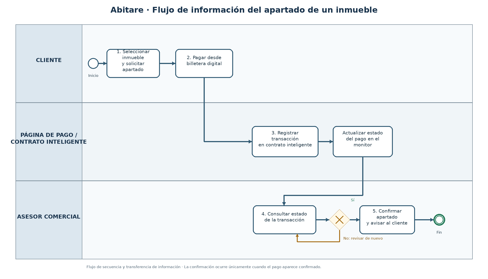

06 · Solución y flujo de información 
 

 

Solución propuesta
Qué cambia en el proceso con la solución (máximo 5 líneas):
 
El cliente paga el apartado del inmueble con criptomonedas desde su billetera digital en una página de Abitare.
El pago queda registrado en un contrato inteligente, que permite consultar el estado de la transacción.
El asesor comercial revisa el monitor de seguimiento en tiempo real, sin depender de comprobantes enviados por WhatsApp.
Cuando el pago se confirma, el asesor informa al cliente y confirma el apartado del inmueble.
La validez legal del contrato inteligente y la facilidad de uso deben validarse antes de implementarlo. 
 
Flujo de información 

Paso	Entrada (qué información llega)	Proceso (qué se hace)	Responsable (quién)	Salida (qué información sale)
1	Decisión del cliente de separar un inmueble e información del inmueble elegido.	Selecciona el inmueble y accede a la página de pago de Abitare.	Cliente	Solicitud de apartado asociada al inmueble.
2	Solicitud de apartado e instrucciones de pago.	Conecta su billetera digital y autoriza el envío de criptomonedas para pagar el apartado.	Cliente	Transacción enviada desde la billetera digital.
3	Datos de la transacción enviada (importe, dirección y registro de la operación).	El contrato inteligente registra la operación y permite consultar su estado en la red blockchain.	Página de pago / contrato inteligente	Registro de transacción y estado consultable del pago.
4	Estado de la transacción registrado en el sistema.	Consulta el monitor de seguimiento y verifica si el pago aparece confirmado. Si no está confirmado, revisa nuevamente el estado antes de confirmar el apartado.	Asesor comercial	Estado del pago verificado.
5	Confirmación del pago en el monitor.	Confirma el apartado y comunica el resultado al cliente.	Asesor comercial	Confirmación del apartado comunicada al cliente.

 
Antes y después 
Proceso actual	Proceso con la solución
El cliente decide separar el inmueble, hace una transferencia bancaria y envía el comprobante por WhatsApp. El asesor revisa manualmente el comprobante; si no logra verificar el pago, lo solicita de nuevo. Mientras se verifica, el inmueble puede seguir disponible para otros clientes.	El cliente inicia el apartado desde la página de Abitare y paga con criptomonedas desde su billetera digital. La transacción queda registrada en un contrato inteligente y su estado puede consultarse en un monitor. El asesor verifica el estado registrado y, cuando el pago está confirmado, confirma el apartado al cliente. La adopción, la seguridad operativa y la validez legal deben comprobarse.
